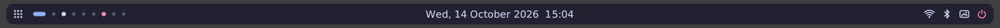
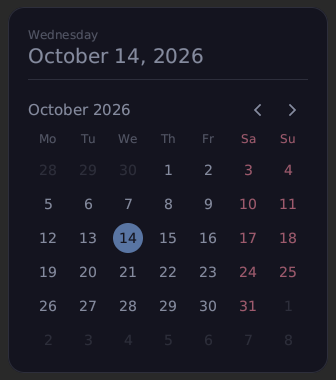

# netline

A minimalist panel for **MangoWM** in pure Zig: no libwayland, no libc, no third-party libraries.
The Wayland protocol, rendering, fonts, icons, the D-Bus client and the JPEG/PNG decoders are all hand-written.

Every icon opens its own menu in the same style — and every menu has its own client, with no external utilities:

| Program | What it is | Talks to |
|---|---|---|
| **netline** | the panel itself | Wayland, mango IPC, the kernel (netlink) |
| **zrun** | app and command launcher (instead of rofi) | .desktop files, PATH |
| **zwifi** | Wi‑Fi menu, including 802.1X enterprise networks | NetworkManager or iwd over D-Bus |
| **zbt** | Bluetooth menu: connecting, pairing, battery | BlueZ over D-Bus |
| **zwall** | wallpaper picker with thumbnails | the zbg daemon |
| **zbg** | wallpaper daemon (instead of swaybg) | Wayland |
| **zpower** | lock, log out, sleep, hibernate, reboot, power off | systemd-logind over D-Bus or doas/sudo rules, mango IPC |
| **zcal** | calendar on a click on the clock | — |



## Features

| Item | Left click | Right click |
|---|---|---|
| Launcher (dot grid) | apps **zrun** | commands **zrun run** |
| mango tags | go to tag | toggleview |
| Wheel over the panel | — | next / previous tag |
| Clock (centered) | calendar **zcal** | — |
| Wi‑Fi | **zwifi** menu | Wi‑Fi on/off |
| Bluetooth | **zbt** menu | Bluetooth on/off |
| Wallpaper | **zwall** picker | random wallpaper |
| Power | **zpower** menu | lock |

Tags: active — a "pill", occupied — a bright dot, empty — a dim one, urgent — red.
Can be switched to numbers (`tag_style = .numbers`).

## Menus

All menus work the same way: a card in the center of the screen with a light dimming around it.
A click outside the card or `Esc` closes the menu, and so does another click on the icon.
While a menu is closed, its program isn't running and uses nothing.
Keyboard control: `Tab`/`Shift+Tab` — through buttons and fields, arrows — through lists, `Enter`, `Esc` — back/close.
Colors are the `menu_*` fields in the theme file; menus pick up changes on the fly.

### Launcher: zrun

- **Apps** — from `.desktop` files in the XDG folders (`~/.local/share/applications`, `/usr/share/applications`,
  Flatpak): names in the system language; `NoDisplay`, `Hidden`, `TryExec`, `OnlyShowIn`/`NotShowIn` are honored;
  your own file in `~/.local/share/applications` overrides a system one with the same name.
- **Commands** — everything in `PATH`; the first row is "run what was typed as is" (via `/bin/sh -c`).
- **Search** is case-insensitive (and treats Cyrillic `ё`/`е` alike): by name (including the untranslated one), program name, description and
  keywords. Matches at the start of a word come first, then inside a word, then fuzzy ones ("gte" → GNOME Text Editor);
  matched letters are highlighted. A query typed in the wrong layout (Russian ЙЦУКЕН instead of QWERTY) is found too: "ашкуащч" is firefox.
- **Frequently launched entries rank higher.** Counters live in `~/.cache/netline/zrun-history`; from "Commands" only
  program names go there, typed lines with arguments are not saved.
- **Icons** — PNG from the icon theme (`icon_theme` or the GTK theme, then hicolor), sized for the screen scale, loaded only
  for the rows shown. SVG is not read: if there is no PNG, a tile with the first letter is drawn. `launcher_icons = false` — tiles only.
- **Fast startup.** The app and command list is cached in `~/.cache/netline/zrun-cache` along with "fingerprints"
  (modification time, size, inode) of everything that was read: the `PATH` and `applications` folders, every `.desktop` file,
  the icon theme folders. At startup only the fingerprints are compared, not hundreds of files; if anything changed
  (a program was installed, a `.desktop` file edited), the list is rebuilt. Icons already scaled for the screen
  live in `zrun-icons`, which also records which entries have no icon. The cache can simply be deleted.

Keys: typing — search, `↑`/`↓` (or `Ctrl+P`/`Ctrl+N`, `Ctrl+K`/`Ctrl+J`), `PgUp`/`PgDn`, `Enter` — launch,
`Shift+Enter` — launch in a terminal (`terminal` in `config.zig`), `Tab` — the other tab, `Esc` — close.
In the "Commands" tab `Ctrl+Enter` runs the typed line as is, even if it matches a program name.
`zrun run` opens "Commands" right away.

Apps are launched without a shell: the `Exec` line is parsed per the spec (quotes, `%i`, `%c`, `%k`;
`%f`/`%u` are removed), the working folder is `Path=` or home, `Terminal=true` runs in a terminal.

### Wi‑Fi: zwifi

- **Network list**: signal level, a lock for secured networks, an `802.1X` mark for enterprise ones,
  a check mark on the current one. Saved networks connect with one click; they have a `⋯` button — "Disconnect" and "Forget network".
- **Personal networks**: open, OWE, WPA/WPA2 and WPA3 (SAE) — the password can be revealed with the eye button.
- **802.1X enterprise networks**:
  - PEAP — phase 2 MSCHAPv2, GTC or MD5;
  - TTLS — phase 2 PAP, MSCHAPv2, MSCHAP or CHAP;
  - EAP-TLS — by certificate: `.p12`/`.pfx` or a certificate + key pair, key password;
  - anonymous login, CA certificate (a path, `~/` is expanded) and the server domain to verify it.
    If only the domain is given, the server is verified against the system certificates.
    Without a CA and domain the menu warns that the server is not verified.
- **Hidden networks** — the "Other network…" button.
- **A wrong password** is detected, the failed profile is removed, and the data stays in the form for correction.

`Ctrl+V` — paste, `Ctrl+U` — clear the field. Input follows the keyboard layout (Latin and Cyrillic), Shift and Caps Lock.
A paste takes the first line only, whole valid UTF-8 characters without control characters, and waits for the clipboard
at most half a second in total.
Authentication and encryption are done by NetworkManager (with wpa_supplicant/iwd underneath): the password is passed to it once
and stored in its profiles (readable by root only). In zwifi's memory passwords are wiped right after sending and on exit.

**Without NetworkManager zwifi talks to iwd directly** (e.g. Void with runit). The list, connecting, hidden networks,
disconnecting, "forget" and the radio toggle work the same way. The password goes to iwd through zwifi's own agent
(`net.connman.iwd.Agent`): iwd asks for it during the connection, the agent answers only iwd's own bus name and wipes the
password right after. iwd saves a network only after it connected. 802.1X networks with iwd need a profile written by root
(`/var/lib/iwd/<SSID>.8021x`, see iwd.network(5)) — the menu says so instead of showing the form. The radio toggle finds the
adapter even while it is off and also lifts an rfkill soft block (iwd's `Adapter.Powered`). D-Bus access to iwd is granted by
its policy file to certain groups (usually `wheel` or `netdev` — check `/usr/share/dbus-1/system.d/iwd-dbus.conf`).

### Bluetooth: zbt

- **Paired devices** with an icon by type (headphones, speaker, keyboard, mouse, gamepad, phone, computer),
  state and battery level ("Connected · 80%"). A click connects; for a connected device (and via the `⋯` button
  or right click) there are "Disconnect" and "Forget device".
- **Add device** — discovering new devices and pairing with our own agent: passkey confirmation (the same digits
  on both screens), showing a passkey to type on a keyboard, PIN entry for old devices. A new device is trusted and connected right away.
- **The toggle** powers the adapter (and lifts the rfkill soft block).
- **Devices without a screen** (headphones, speakers, mice, gamepads) pair without a code: zbt confirms by itself,
  and for old devices with a hard-wired PIN it first tries `0000`, then `1234`; if those fail it asks for the PIN.
  Code-less pairing ("Just Works") is confirmed by zbt itself for any device you selected.
- Discovery shows devices with a name or a known type; nameless BLE noise (other people's phones, tags) is hidden.
- **Diagnostics:** `zbt scan [seconds]` — discovery (20 seconds by default) and the full list of what bluetoothd sees: device type, classic or BLE, manufacturer; if there is nothing to show in the menu, a hint on what to do.

The pairing agent accepts requests only from bluetoothd itself: another program on the bus cannot slip in
a forged request. The device list, too, follows signals from bluetoothd only (zwifi — from NetworkManager only):
a signal another program sends straight to the menu is ignored, so it can't add a fake device or "turn off" Wi‑Fi on screen.
Canceling or closing the menu during pairing rejects the device's request.

### Wallpaper: zwall and zbg

**zbg** is a daemon that draws the wallpaper on all monitors (instead of swaybg). Monitors can be plugged and unplugged on the fly,
integer and fractional scale are supported (the image is rendered at the screen's native resolution, no blur).
The choice is remembered in `~/.cache/netline/wallpaper` and restored at startup.

**zwall** is a grid of thumbnails from the wallpaper folder (`wallpaper_dir`, `~/Pictures/wallpapers` by default):

- a click changes the wallpaper right away, the menu stays open, you can try several in a row;
- "Random" — a random wallpaper (a right click on the icon does the same: `zwall random`);
- arrows, `PgUp`/`PgDn`, `Home`/`End` and the wheel — navigation, `Enter` — apply;
- thumbnails are made in the background (visible ones first) and cached in `~/.cache/netline/thumbs`, so reopening is instant;
  thumbnails of deleted files are removed from the cache. Only the thumbnails of the visible screen and the screens above and below
  (at most 36) are kept in memory, right at the on-screen tile size: ~1.5 MB at 1× scale, ~6 MB at 2×; the frame draws them
  pixel for pixel, with no rescaling. The rest are loaded from the cache while scrolling.

Formats: **JPEG** (baseline and progressive, EXIF rotation) and **PNG** (all types, transparency, interlace).
WebP, AVIF, HEIC and rare JPEGs (CMYK, lossless, arithmetic coding) are not supported —
such files are marked "can't open". A broken or partly downloaded file won't spoil the wallpaper: zbg decodes
the image first and only then switches. `wallpaper_mode` — `.fill` (fill with cropping) or `.fit` (whole, with `desktop`-colored borders).

### Power: zpower

Lock, log out, sleep, hibernate, reboot, power off — only the actions
available on the system (what logind allows) are shown. Hotkeys: `L` — lock, `E` — log out, `S` — sleep,
`H` — hibernate, `R` — reboot, `P` — power off. Log out, reboot and power off ask for confirmation
(pressing the same key again means "yes"; turned off with `power_confirm = false`). The screen is locked before sleep
(`lock_before_suspend`). If polkit doesn't allow an action, the menu says so.

Power off and sleep go through systemd-logind over D-Bus (no `systemctl`), log out through the mango IPC (`quit`), or through
logind if mango is unavailable. The header shows the user, host name and uptime.

**Without logind** (runit + seatd) reboot and power off run `reboot_cmd` / `poweroff_cmd` from `config.zig` —
by default `doas -n /usr/bin/reboot` and `doas -n /usr/bin/poweroff`; if doas isn't installed, `reboot_fallback` /
`poweroff_fallback` run instead (`sudo -n …`) — in the same process, with no shell and no extra process.
`-n` makes them fail instead of asking for a password nobody can type.
One narrow rule without a password is needed, either for doas in `/etc/doas.conf`:

```
permit nopass youruser as root cmd /usr/bin/poweroff args
permit nopass youruser as root cmd /usr/bin/reboot args
```

or for sudo (`sudo visudo -f /etc/sudoers.d/netline`):

```
youruser ALL=(root) NOPASSWD: /usr/bin/reboot, /usr/bin/poweroff
```

If doas is installed but the rule is for sudo, put the sudo command in `reboot_cmd`/`poweroff_cmd` itself.
Without logind sleep and hibernate are hidden (with elogind installed, zpower uses it like logind and they are back).
If the command didn't take the system down in 4 s, the menu says "Not allowed — check the doas/sudo rule".

### Calendar: zcal



The month with "today" highlighted, weeks start on Monday, weekends are colored.
`←`/`→` (or `PgUp`/`PgDn`, the wheel) — month, `↑`/`↓` — year, `Home` or a click on the month name — back to today.

### Hotkeys in mango

Every menu can also be opened from the keyboard, e.g. in `~/.config/mango/config.conf`:

```ini
bind=SUPER,D,spawn,zrun
bind=SUPER,R,spawn,zrun run
bind=SUPER,W,spawn,zwifi
bind=SUPER,B,spawn,zbt
bind=SUPER,P,spawn,zwall
bind=SUPER,Escape,spawn,zpower
bind=SUPER,C,spawn,zcal
```

## Colors

Every item has its own color: panel background, border, highlight, launcher, each tag state, clock,
Wi‑Fi (lit/unlit arcs, strike-through), Bluetooth (on/connected/off), wallpaper, power, the desktop color under the wallpaper
and all menu colors.

Two ways to change them:

- **Without rebuilding** — the file `~/.config/netline/theme` (or `$XDG_CONFIG_HOME/netline/theme`).
  Copy `theme.example` and edit it: the panel, menus and zbg reread the file right after you save it
  (once, 80 ms after the last change — an editor's save is several file events) and redraw only if a color actually changed.
  ```ini
  background = #2e3440e6
  clock      = #ebcb8b
  power      = #a3be8c
  ```
  The format is `#RRGGBB` or `#RRGGBBAA` (AA is opacity). Colors that aren't set come from `config.zig`.
  The `~/.config/netline` folder must exist before the panel starts — otherwise live reload only works after a restart.
- **Defaults** — `theme` in `src/config.zig`. A typo in a color there is a build error.

A border around the panel is enabled in `config.zig`: `border_width = 1`.

## Clock font

The date and time are drawn with one TrueType font: the first file found in `clock_font_paths` in `src/config.zig`
(by default Noto Sans, then DejaVu Sans). To use a different font, put the path to its `.ttf` first in that list and rebuild.
Only TrueType outlines (glyf) are supported, not CFF/OTF. A font with tabular (equal-width) digits keeps the clock from
shifting as the minutes change — Noto Sans and DejaVu Sans have them. If no font is found, the clock falls back to
the panel's vector digits, and the date is shown in numbers: `12.10.2026  13:31`.

## System load

The panel uses practically nothing while nothing changes (measured: 0 wakeups and 0 CPU ticks over 8 seconds idle).

- **No once-a-second polling.** The clock is woken by a timer exactly at the minute boundary (`CLOCK_REALTIME`, re-armed when the clock is changed).
  Wi‑Fi and Bluetooth are updated from kernel events: interface changes (netlink), rfkill/bluetooth uevents
  and Bluetooth adapter power (the mgmt control channel, no root needed).
- **The kernel drops unneeded events.** BPF filters are attached to the event sockets: the panel doesn't wake up for the battery
  (an event for every percent of charge), USB, sound, backlight or Wi‑Fi scans — only for what
  changes the icons. udevd signs the subsystem in its events with a hash (libudev filters the same way); without udevd the panel listens
  to kernel events as before.
- **The fallback poll runs only when needed**: every 30 s (`status_poll_s`) while Wi‑Fi is connected (signal level
  sends no events), while there is no connection to mango, and if the kernel gave no mgmt channel for Bluetooth.
  Otherwise the panel sleeps until an event.
- **Only what changed is drawn.** A new frame is compared to the previous one. If the pixels match, the compositor isn't touched at all.
  If not, only the changed rectangles are sent to it (when the minute changes — only the rectangle with the changed digits, not the whole panel).
  That's the minimum of work for both the CPU and the compositor's GPU.
- Buffers in shared memory (memfd), no dynamic allocations, a single thread.
- **Drawing is cheap.** Color blending is integer (two channels in one word); for rounded
  rectangles the distance function is evaluated only near the edges, and the middle is filled in one run.
  Icons are computed via the distance function once: the coverage mask is cached, and in the following
  frames it is just blended with a color — 7–30 times faster.
  Text (the clock and the menus): a "character → glyph" cache, rasterized glyphs are cached, and a binary search over the font table (~40% faster).
- **Tags are redrawn only if they changed** — the mango IPC also sends events for things the panel doesn't show.
  Every line of `watch all-tags` is a full snapshot of all monitors, so of the lines that arrived together only the last one
  is parsed; monitors missing from the snapshot (unplugged) free their slot.
- **Small binaries.** Our own panic handler instead of the standard one (stack printing and formatting),
  buffers and zero-initialized tables in `.bss` (no space in the file, no memory until touched): all eight programs together
  are about 1.5 MB (ReleaseSafe, x86_64), the panel in memory is ~0.9 MB
  on a 1600-pixel-wide screen, 0.4 MB of which are the two frame buffers the compositor reads.

Measured (aarch64, headless sway): 10 s idle — 0 wakeups and 0 µs of CPU; 400 mouse movements
with icon highlighting — 33 ms of CPU; 200 tag events — 78 ms.

Menus run only while open. The screen dimming is one pixel stretched by the compositor
(`wp_viewporter` + `single-pixel-buffer`), so there's no extra memory and no noticeable GPU work.
Menus open without extra steps: the broker runs simple commands from `config.zig` directly via `execve`
(no `/bin/sh` per click), the keyboard layout is parsed through a hash table of key names,
and the D-Bus connection sends AUTH, BEGIN and Hello in one round trip.

**zwifi and zbt run on signals, not polling.** zwifi subscribes to its device's signals in NetworkManager:
a new network appears in the list tens of milliseconds after NM found it (previously up to 3 s,
on the next tick), and the connection result is visible right away from the device's state change. zwifi itself only
asks NM to scan every 10 s. It collects a batch of signals (access points, `LastScan`) for 40 ms and rereads the list
once. zbt loads the devices once and then maintains the table from bluetoothd signals
(`InterfacesAdded`/`Removed`, `PropertiesChanged`): during discovery it doesn't call bluetoothd at all
(previously it fetched all objects on every signal, up to three times a second), and a found device is drawn the same
moment. The signal level (RSSI) changes all the time, so the list order is recomputed once per tick,
and a redraw is needed only if rows swapped places.

Measured (aarch64 VM, NetworkManager + hwsim, bluetoothd + btvirt):

| | before | after |
|---|---|---|
| zwifi: NM calls over 30 s with the menu open | 47–53 | 15–21 |
| zwifi: new network in the list after the NM signal | 0.1–3 s | 0–45 ms |
| zwifi: state requests while connecting | 41 | on signals |
| zbt: bluetoothd calls over 20 s of discovery | a full dump on every signal | 0 |
| zbt: new device in the list after the signal | 120–350 ms | 0–2 ms |
| zbt: CPU over 20 s of discovery | 98–117 ms | 64–88 ms |

**Partial redraw in menus.** The dots animation ("Searching...", "Connecting...") and the highlight of the row under the pointer
redraw only their own band of rows: the frame takes the previous one as the base, and the drawing primitives skip everything outside
the band. The base isn't copied whole: the buffer being drawn already holds the frame before the last one, so only the rows that changed
in the last frame are copied (a few rows instead of 0.8 MB at 1× and 3.2 MB at 2× per animation step).
The dots update twice a second, not three times.

**Saving the theme** costs one reread and at most one frame: before, vim's save (rename to a backup, create, write)
meant three rereads and three frames of the panel and of every open menu (one of them in default colors), and zbg decoded the
wallpaper three times. Now zbg decodes it again only if the `desktop` color changed.

**zwifi starts with fewer bus round trips**: the NetworkManager name owner and the device list, then the types of all
devices and the radio state — two batches instead of a chain of calls; match rules are sent without waiting for a reply.
The D-Bus client steps over handled messages instead of shifting the buffer after each one.

Measured in the same VM, before → after this version:

| | before | after |
|---|---|---|
| panel: CPU for a burst of 2000 mango lines | 32 ms | 2.2 ms |
| menus: partial frame (dots animation), median at 1× | 404 µs | 190 µs |
| zbt: CPU over 20 s of discovery | 27–35 ms | 20 ms |
| zwifi: launch → first frame, median | 12.5 ms | 6.5 ms |
| zwifi: sequential waits for a bus reply at startup | ~19 | ~7 |
| theme saved by vim: panel frames / zbg CPU with a PNG wallpaper | 3 / 47 ms | 1 / 0 ms |
| theme saved without a color change: panel frames | 4 | 0 |

The next version, measured the same way:

| | before | after |
|---|---|---|
| all eight binaries, x86_64 / aarch64 | 1.65 / 1.48 MB | 1.52 / 1.35 MB |
| panel: RSS on a 1600-pixel screen | 916 KB | 880 KB |
| panel: the fallback poll while Wi‑Fi is connected | rereads Wi‑Fi and Bluetooth | reads only the signal level |
| zbt with Bluetooth on demand: wakeups over 5 s after starting the service | 10 | 0 |
| `zbt toggle`: time to return | 308 ms | 3 ms |
| zwifi (NetworkManager): state requests while connecting | every 0.5 s | once a second, plus on signals |
| menus: frames for pressing Shift, Ctrl, Alt alone | 1 each | 0 |

### Timing: `NETLINE_TRACE=1`

The timing code exists only in a `-Dtrace=true` build (a normal build has none of it). With the variable `NETLINE_TRACE=1`
any program of such a build writes to stderr when and why it wakes up and how long each frame takes.
Stamps are monotonic time in milliseconds and can be compared across processes
(a click in the panel → the first frame of the menu):

```sh
zig build -Doptimize=ReleaseSafe -Dtrace=true -p /tmp/netline-trace
pkill netline; NETLINE_TRACE=1 /tmp/netline-trace/bin/netline 2>&1 | tee /tmp/netline.log
```

When idle the log should contain only `wakeup: clock` lines once a minute
(and `poll` every 30 s if Wi‑Fi is connected).

**zbg** wakes up only when the wallpaper or the monitors change. The image is decoded once for all monitors
(JPEG straight at a reduced size if the screen is smaller than the photo), and after drawing all memory goes back to the system:
when idle zbg takes about 0.2 MB. The wallpaper buffer is destroyed as soon as the compositor has released it
(wlroots with GPU rendering uploads the image into a texture and releases the buffer right away).

The JPEG decoder: integer inverse DCT on vectors, Huffman with a "code and value in one lookup" table,
a baseline image turns into pixels right away (the whole frame's coefficients aren't stored — for a 24-megapixel
photo that's 72 MB). Scaling to the screen keeps a few rows in memory, not an intermediate image.
A 6000×4000 photo → 1600×900 wallpaper takes about 0.16 s, → 4K about 0.37 s; a thumbnail 0.04 s.

For minimal GPU load: keep `blur_layer=0` in mango and, if you don't need transparency, make the background opaque (`#RRGGBB`):
with an opaque `background` (`menu_background` for the menus) the panel and the menu card hand the compositor an opaque region —
the surface without its rounded corners — and it neither draws nor blends the windows and wallpaper underneath. zbg's wallpaper
is always opaque (XRGB). With a translucent background nothing extra is sent.

## Security

The panel is split into two processes.

**The broker** forks off first, before connecting to Wayland, and can do only three things:
- run a command from the table **built in at compile time** from `config.zig` (simple ones directly via `execve`,
  ones with shell special characters via `/bin/sh -c`);
- send mango a `dispatch` of a strictly checked form (`viewcrossmon,N,MONITOR`, `view,N,0`, `toggleview,N`);
- open the mango IPC socket and hand it to the panel.

**The panel** locks itself down after initialization:
- **seccomp** — a system call allowlist. No `exec`, `fork`, `socket`, `connect`, `ptrace`, `mprotect`, and no signal
  handlers or masks (`rt_sigaction`, `rt_sigprocmask` — checked with strace: no program needs them once locked down).
  `mmap` is allowed only without `PROT_EXEC`, `openat` read-only, `ioctl` only the Bluetooth state request.
  Any other call kills the process immediately.
- **Landlock** — read access only to `/sys`, `/proc`, tzdata and the theme folder. Writing is forbidden everywhere, TCP is forbidden,
  signals and abstract sockets only within the sandbox.
- `no_new_privs`, `dumpable=0` (no ptrace attach), running as root is not allowed.

Even if a vulnerability is found in the panel, the compromised process can't launch a program (other than the ones you wrote in), open the network, write a file or read your keys.
The broker is deliberately not sandboxed: the programs it launches (a terminal, sudo, the launcher) must work as usual.

**Menus and zbg** lock themselves down the same way — right after connecting to Wayland and their services (D-Bus, the zbg socket):
the same seccomp without `exec`, `fork`, `socket`, `connect`, and Landlock where each one gets only what it needs:

| | read | write |
|---|---|---|
| zwifi, zbt, zpower, zcal | theme folder | — |
| zrun | theme folder and icon folders | — (the icon cache file is opened up front) |
| zwall | theme and wallpaper folders | the thumbnail cache only |
| zbg | theme and wallpaper folders | — (the choice file is opened up front) |

zpower locks the screen through its own small broker, which can only run `lock_cmd`.
zrun reads the apps, `PATH` and the history before the sandbox and immediately forks its broker: an app is named to it
only by its number in the already-read list, and the broker parses `Exec` and launches it itself, without a shell. A line from the
"Commands" tab is run by the broker via `/bin/sh -c` — the same as a terminal would.
A repeated launch closes a menu only if it comes from the same user; only the same user can control zbg as well.
The menus and zbg find each other through abstract sockets (`zwifi-<uid>`, `zbg-<uid>`), and anyone on the machine can create
such a name first. So the owner is checked (`SO_PEERCRED`): a name taken by another user doesn't make a menu or zbg exit
(they run without the lock or the control socket and say so), and zwall doesn't talk to a stranger's "zbg".
D-Bus signals are accepted only from the service itself (NetworkManager, iwd, bluetoothd), by its unique bus name.
Frame buffers are created with `MFD_NOEXEC_SEAL` (Linux ≥ 6.3, otherwise as before): this memory can never be made executable,
and on kernels 6.3–6.5 with `vm.memfd_noexec = 2` the panel would otherwise get no buffers at all.
The image decoders check all bounds and limit sizes (up to 16384 px per side, 80 MP, files up to 128 MB; zrun takes icons
up to 2048×2048, so one huge PNG among them can't make the launcher take hundreds of megabytes);
broken files and "bombs" give an error, not a buffer overrun; they have been through mutation fuzzing.
The font engine bounds composite glyphs (at most 64 outlines per glyph), so a crafted font can't hang the drawing.

Parsing of all input data (the Wayland protocol, D-Bus, mango JSON, netlink, tzdata, the theme file, JPEG, PNG) is bounds-checked and protected against overflows.

If the kernel has no Landlock, the programs run with seccomp alone and say so on stderr.
A seccomp violation shows up in `dmesg` (`audit: type=1326 ... syscall=N`). For debugging the sandbox can be turned off: `sandbox = false` in `config.zig`.

## Requirements

- **Zig 0.17** (tested on 0.17.0).
- **Linux ≥ 5.13** for Landlock (optional), x86_64, aarch64, riscv64.
- **MangoWM ≥ 0.14** — IPC via `$MANGO_INSTANCE_SIGNATURE`. The old `dwl-ipc` was removed from mango in 0.15 and is not supported.
- A TrueType font for the clock and menus (DejaVu Sans or Noto Sans are almost everywhere; path lists — `clock_font_paths` and `font_paths` in `config.zig`).
- Services: **NetworkManager or iwd** (zwifi), **BlueZ** (zbt), **systemd-logind**, elogind or narrow doas/sudo rules (zpower).
- Programs: `swaylock` (or any other command in `lock_cmd`) and a terminal for `Shift+Enter` in zrun (`foot` by default).
  `rofi`, `nmcli`, `bluetoothctl` and `swaybg` are no longer needed.

## Building and installing

Run the commands one at a time (they work in both bash and fish). The example is for Arch; on other distributions install
the same packages with your package manager (on Debian/Ubuntu: `network-manager`, `bluez`, `fonts-dejavu-core`, `swaylock`, `foot`).

### 1. Packages and services

```sh
sudo pacman -S --needed git networkmanager bluez bluez-utils ttf-dejavu swaylock foot
```

```sh
sudo systemctl enable --now NetworkManager bluetooth
```

The menu doesn't need `bluez-utils` — it's only for diagnostics (`bluetoothctl`). zwifi works through NetworkManager,
or through iwd alone when NetworkManager isn't running; if Wi‑Fi used to be brought up with netctl or a hand-started
wpa_supplicant, turn that off.

### 2. Zig 0.17

It has to be 0.17 (if `zig version` already shows `0.17.x`, you can skip this step):

```sh
cd ~
```

```sh
curl -LO https://ziglang.org/download/0.17.0/zig-x86_64-linux-0.17.0.tar.xz
```

```sh
tar -xf zig-x86_64-linux-0.17.0.tar.xz
```

Add it to `PATH` — in fish:

```sh
fish_add_path ~/zig-x86_64-linux-0.17.0
```

in bash/zsh — with the line `export PATH="$HOME/zig-x86_64-linux-0.17.0:$PATH"` in `~/.bashrc` or `~/.zshrc`.
Check: `zig version` should print `0.17.0`. On ARM use `aarch64` instead of `x86_64`.

### 3. Clone

`lite` is the only branch:

```sh
git clone -b lite https://github.com/FalconBinary/netline.git ~/netline
```

```sh
cd ~/netline
```

### 4. Build and install

```sh
zig build -Doptimize=ReleaseSafe
```

```sh
install -Dm755 zig-out/bin/zbg zig-out/bin/zbt zig-out/bin/zcal zig-out/bin/netline zig-out/bin/zpower zig-out/bin/zrun zig-out/bin/zwall zig-out/bin/zwifi -t ~/.local/bin/
```

`~/.local/bin` must be in `PATH` (in fish: `fish_add_path ~/.local/bin`). All eight programs must be
in the same folder — the panel looks for the menus next to itself.

`ReleaseSafe` keeps bounds checks at run time (extra protection for parsing files and network data)
and is almost as fast; `ReleaseSmall` gives smaller binaries, but without those checks.

### 5. Theme and wallpaper folder

```sh
mkdir -p ~/.config/netline ~/Pictures/wallpapers
```

```sh
cp theme.example ~/.config/netline/theme
```

Images (JPEG, PNG) go in `~/Pictures/wallpapers`. Colors go in `~/.config/netline/theme`; the panel and menus
pick up changes on the fly.

### 6. Autostart in mango

In `~/.config/mango/config.conf`:

```ini
exec_once=zbg
exec_once=netline
```

Remove lines with `swaybg`, `waybar` or another panel — otherwise you'll get two panels and two wallpapers
(zbg restores the chosen wallpaper by itself). Hotkeys for the menus are in the section
["Hotkeys in mango"](#hotkeys-in-mango).

### 7. Run

Log out of the mango session and log back in — or start them from a terminal inside mango:

```sh
zbg &
```

```sh
netline &
```

### If something is wrong

- **The panel didn't appear** — run `netline` in a terminal and read the message: most often it's an old mango
  (≥ 0.14 is needed) or it wasn't started from a mango session.
- **zwifi: "Wi‑Fi service is unavailable"** — neither NetworkManager nor iwd is running (step 1).
- **zbt doesn't see a device** — `zbt scan` shows everything bluetoothd sees and suggests what to do.
- **Wrong font, terminal or lock command** — `clock_font_paths`, `font_paths`, `terminal` (`foot`), `lock_cmd`
  (`swaylock -f`) and `wallpaper_dir` in `src/config.zig`; after editing — step 4 again.

### Updating

```sh
cd ~/netline
```

```sh
git pull
```

and step 4 again. If `git pull` reports diverged history (the history was rewritten on 13 October 2026),
run `git fetch origin` and `git reset --hard origin/lite` once
(local edits in this copy will be lost).

### Upgrading from zpanel

The project used to be called zpanel. After installing netline:

- in `~/.config/mango/config.conf` replace `exec_once=zpanel` with `exec_once=netline`;
- move the theme: `mv ~/.config/zpanel ~/.config/netline`;
- move the caches (optional, they are rebuilt anyway): `mv ~/.cache/zpanel ~/.cache/netline`;
- remove the old binary: `rm ~/.local/bin/zpanel`.

## Configuration (`src/config.zig`)

- `position` — `.top` / `.bottom`; `height`, `margin_edge`, `margin_side`, `radius`, `border_width` — geometry.
- `left` / `right` — item order; the clock is always in the center.
- `clock_format` — `.full` (default: `Mon, 12 October 2026  13:31`), `.hm`, `.hms` (wakes the panel every second) or `.date_hm`.
- `clock_size`, `clock_font_paths` — clock digit height and font (see [Clock font](#clock-font)).
- `hover_effect` — highlight under the pointer.
- `launcher`, `clock`, `wifi`, `bluetooth`, `wallpaper`, `power` — commands for the left/right/middle button.
- `font_paths`, `menu_width`, `menu_height`, `menu_radius` — menus.
- `launcher_width`, `launcher_rows`, `launcher_icons`, `icon_theme`, `terminal` — the zrun launcher.
- `wallpaper_dir`, `wallpaper_mode` — the wallpaper folder and how it's fitted.
- `lock_cmd`, `power_confirm`, `lock_before_suspend` — locking and confirmations in the power menu.
- `reboot_cmd`, `poweroff_cmd` (+ `*_fallback` if doas isn't installed) — reboot and power off without logind; `null` hides the buttons.
- `bt_service_on_cmd`, `bt_service_off_cmd` — Bluetooth on demand: when bluetoothd isn't running, the zbt toggle (and
  `zbt toggle`) starts it with this command and waits for it; turning Bluetooth off stops it again. `null` — not used.
- `status_poll_s`, `sandbox` — the fallback poll (only while Wi‑Fi is connected) and the sandbox.

All programs must be in the same folder as `netline` (or in `PATH`) — the broker looks for them next to the panel.

## Layout

```
src/
  main.zig     panel: event loop, a bar per monitor, input, layout, drawing, damage
  ui.zig       shared menu framework: card, dimming, widgets, keyboard, focus, sandbox
  wifi.zig     zwifi: network list, forms, clipboard
  nm.zig       NetworkManager client (scanning, PSK/SAE/PEAP/TTLS/TLS, forget, disconnect)
  bt.zig       zbt: devices, discovery, pairing screens
  bz.zig       BlueZ client: adapter, devices, battery, our own pairing agent, rfkill
  wall.zig     zwall: thumbnail grid, cache, talking to zbg
  zbg.zig      wallpaper daemon: a background layer on every monitor, scale, control socket
  img.zig      JPEG and PNG decoders (our own inflate) and high-quality scaling
  power.zig    zpower: logind actions, confirmations, locking
  cal.zig      zcal: calendar
  run.zig      zrun: apps and commands, icons, history, launch broker
  desktop.zig  .desktop and Exec parsing, search with highlighting, layout fixing (tests: zig test src/desktop.zig)
  dbus.zig     D-Bus client: authentication, marshalling, calls, async replies, signals, incoming calls
  ttf.zig      TrueType font engine: glyphs, curves, antialiasing, cache
  xkb.zig      XKB keymap parsing: groups, Shift, Caps Lock, Latin and Cyrillic
  wl.zig       Wayland wire protocol: serialization, event parsing, fd passing
  sys.zig      raw Linux system calls, argv and environment
  rt.zig       small panic handler and std options for all programs
  broker.zig   broker process: running commands, mango IPC
  sandbox.zig  seccomp-bpf and Landlock
  theme.zig    theme file and its reloading (inotify)
  color.zig    color parsing
  draw.zig     antialiased rasterization (SDF), images, vector digits and icons
  mango.zig    mango tag stream + a tiny JSON tokenizer
  status.zig   Wi‑Fi and Bluetooth from the kernel, netlink events
  tz.zig       TZif and POSIX TZ parsing
  config.zig   settings and default colors
```

## License

Copyright (c) 2026 Denys ([FalconBinary](https://github.com/FalconBinary))

netline is free software: you can redistribute it and/or modify it under the terms of the
GNU General Public License version 3 or (at your option) any later version.
The full text is in the [LICENSE](LICENSE) file.

The program is distributed "as is", without any warranty, including any warranty
of fitness for a particular purpose. The author is not liable for any damage
arising from its use (sections 15 and 16 of GPL-3.0).
